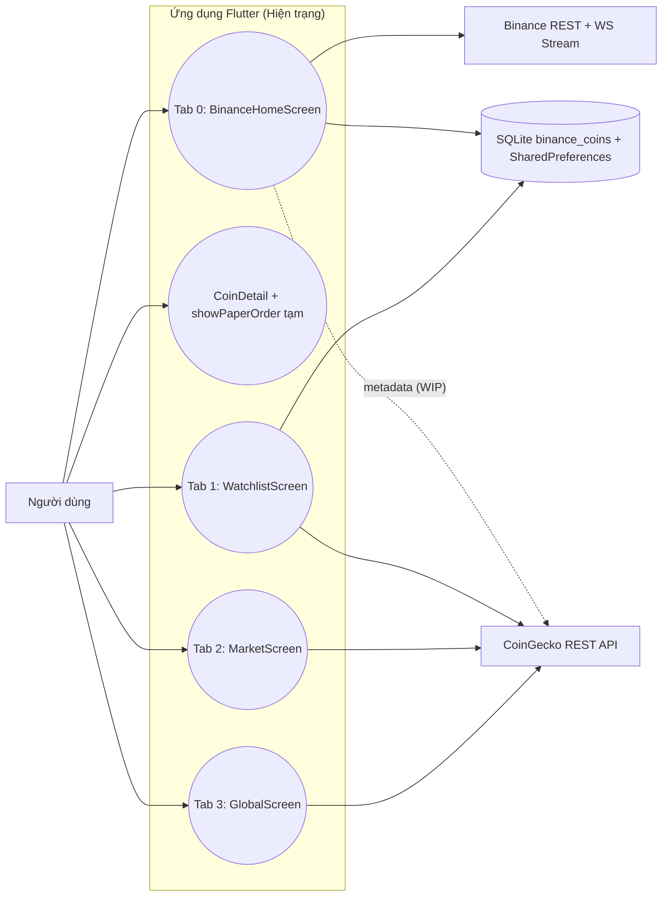
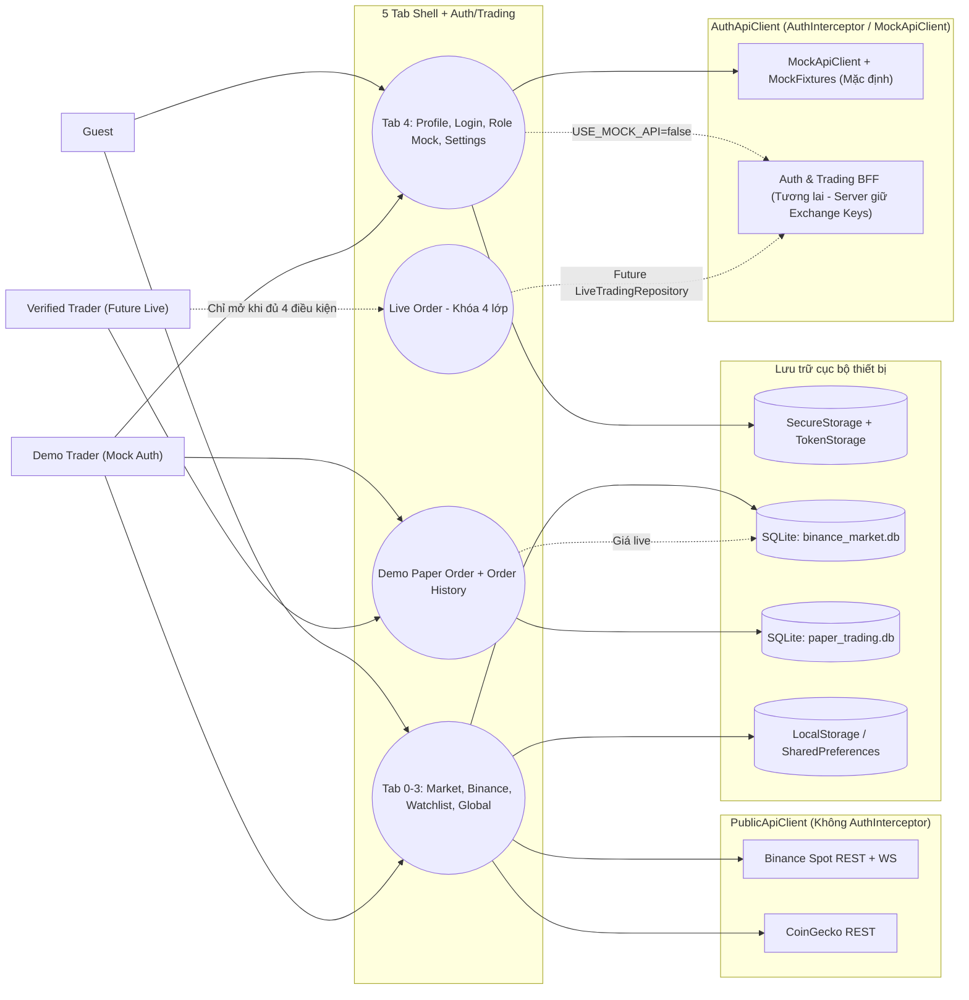
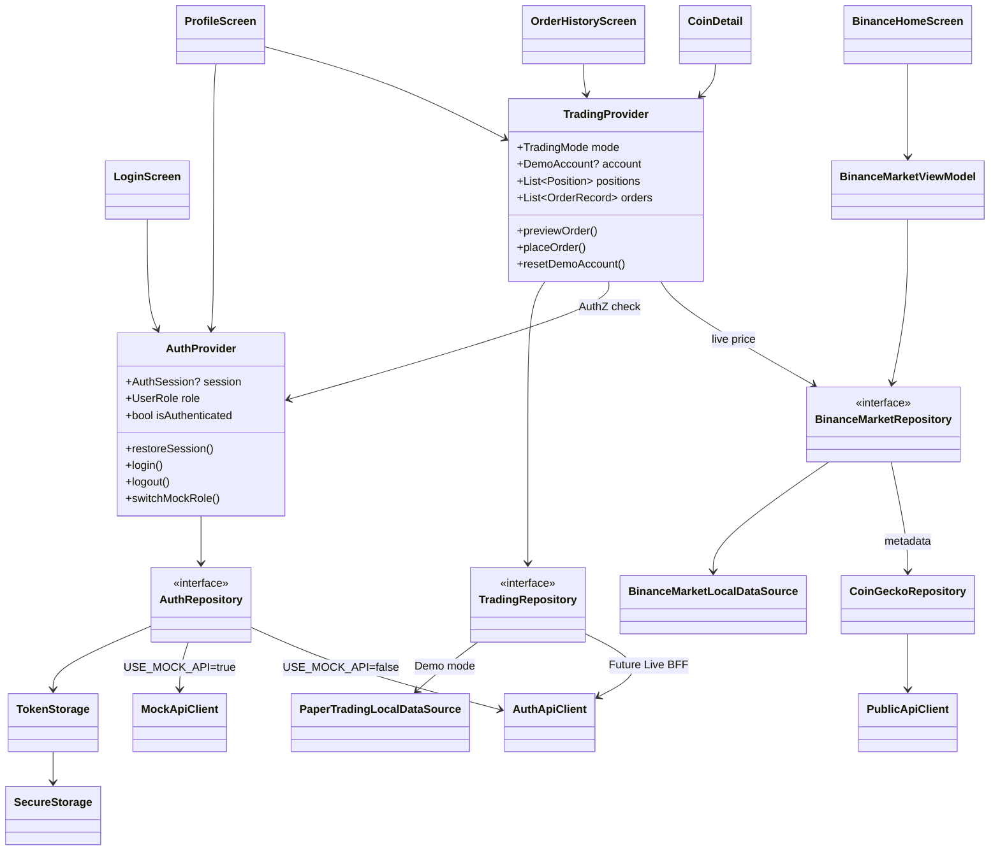
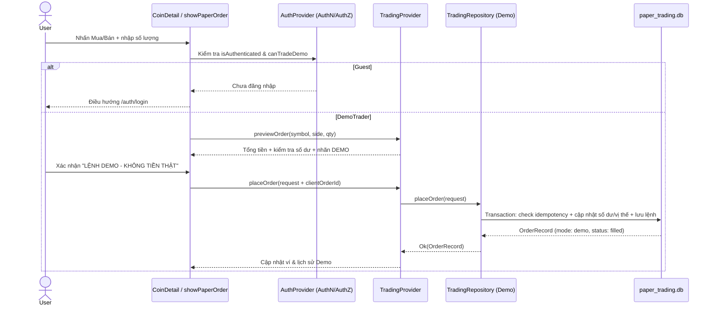
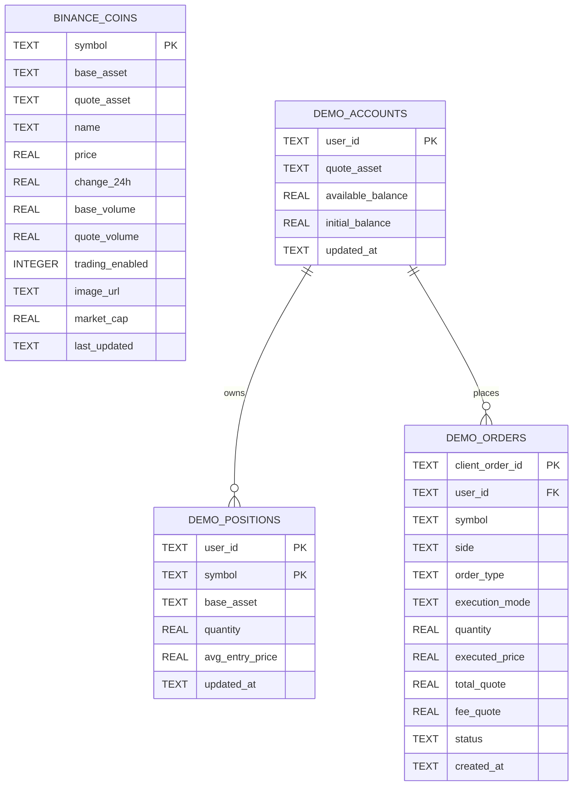

# Sơ đồ Dự án (Chuẩn HHM · Binance Trading-Ready)

Tách rõ **Phần 1: Hiện trạng mã nguồn** và **Phần 2: Kiến trúc Đích (Safe Demo Mock First + AuthN/AuthZ Mock trên cấu trúc tầng HHM)**.

---

## Phần 1: Hiện trạng (As-Is)

---

## Phần 2: Kiến trúc Đích (HHM Layer-First · Trading-Ready)

### 2.1 Trust Boundary & Use Case

### 2.2 Class Diagram (Theo đúng thư mục `core/` · `data/` · `providers/` · `views/`)

### 2.3 Sequence: Đặt lệnh Paper Trading An Toàn

### 2.4 ERD SQLite Cục bộ

| Kho lưu trữ | Dữ liệu |
|---|---|
| `binance_market.db` (SQLite) | `binance_coins` (offline-first Binance snapshot) |
| `paper_trading.db` (SQLite) | `demo_accounts`, `demo_positions`, `demo_orders` |
| `SecureStorage` (`flutter_secure_storage`) | `access_token`, `refresh_token`, `token_expires_at`, `mock_role` |
| `LocalStorage` (`SharedPreferences`) | `watchlist_coin_ids`, `locale`, `theme_mode`, `onboarding_seen`, `remote_config`, `device_id` |
