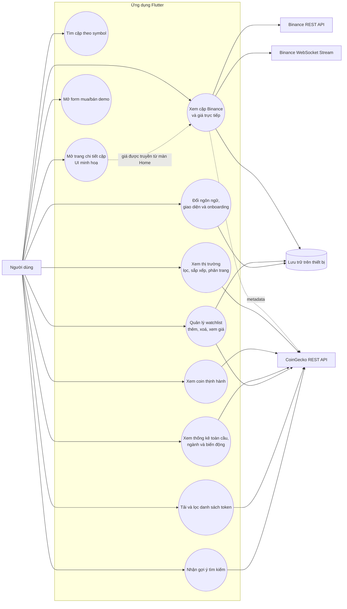
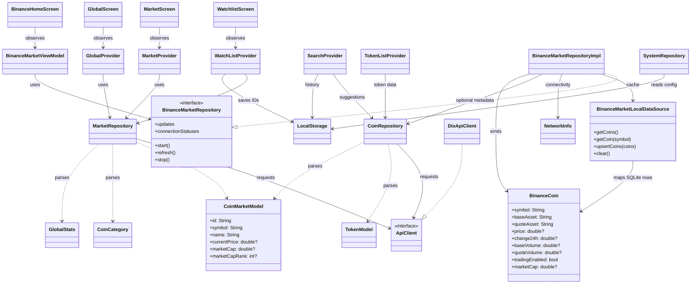
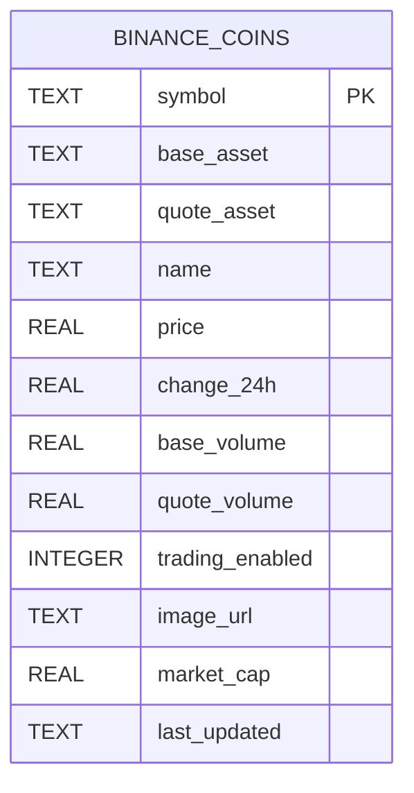

# Sơ đồ dự án

Các sơ đồ mô tả **mã hiện tại**, không phải kế hoạch chuyển đổi. Ứng dụng
đang có hai luồng dữ liệu thị trường: Binance cho màn hình Home và CoinGecko
cho danh sách/thị trường/tổng quan/watchlist. Một số màn hình chi tiết và giao
dịch vẫn là giao diện minh hoạ.

## Use case

`Mở form mua/bán demo` không thực hiện lệnh Binance. Watchlist lưu CoinGecko ID
ở SharedPreferences; nó không dùng cặp Binance được lưu trong SQLite.

## Class diagram

`CoinMarketModel`, `CoinCategory`, `GlobalStats` và `TokenModel` là model của
dữ liệu API; chúng không phải các bảng trong SQLite. `BinanceCoin` là model
cho snapshot Binance cục bộ.

## ERD lưu trữ cục bộ

SQLite hiện chỉ tạo bảng `binance_coins`; `base_asset` có index nhưng không có
foreign key. Dữ liệu còn lại được lưu riêng bằng SharedPreferences, không phải
bảng quan hệ:

| Khoá | Dữ liệu |
|---|---|
| `watchlist_coin_ids` | Danh sách CoinGecko ID được theo dõi |
| `coingecko.recent_search` | Lịch sử từ khoá tìm kiếm |
| `coingecko.recent_viewed` | Danh sách token xem gần đây dạng JSON |
| `coingecko.locale`, `coingecko.theme_mode` | Tuỳ chọn ngôn ngữ và giao diện |
| `coingecko.onboarding_seen` | Trạng thái onboarding |
| `coingecko.remote_config` | Cấu hình cache cục bộ |
| `coingecko.device_id` | Mã thiết bị |

Không có tài khoản người dùng, danh mục đầu tư, lệnh giao dịch hay quan hệ
foreign key được lưu trong cơ sở dữ liệu hiện tại.
